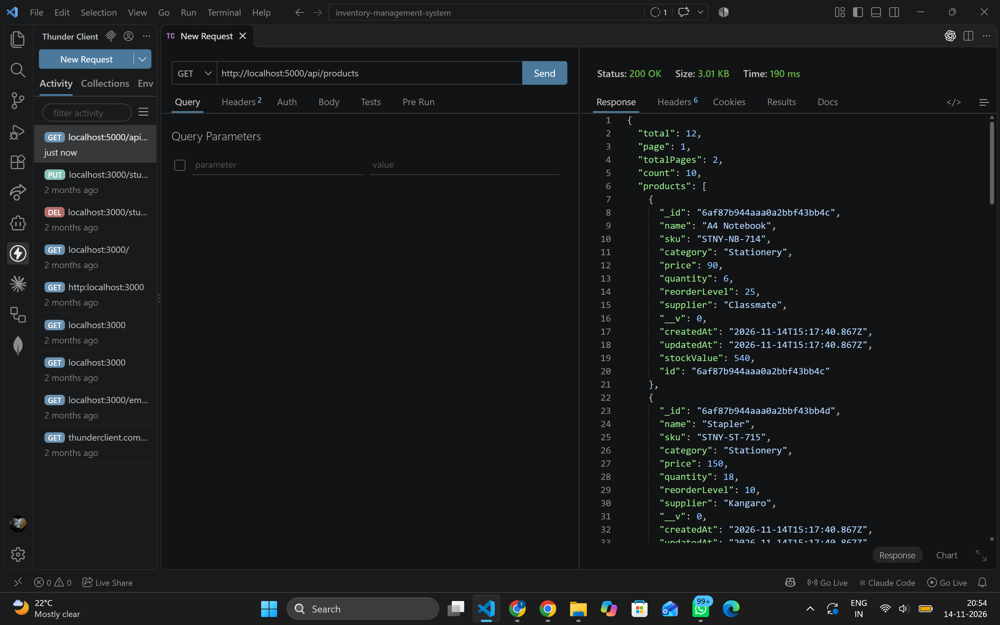
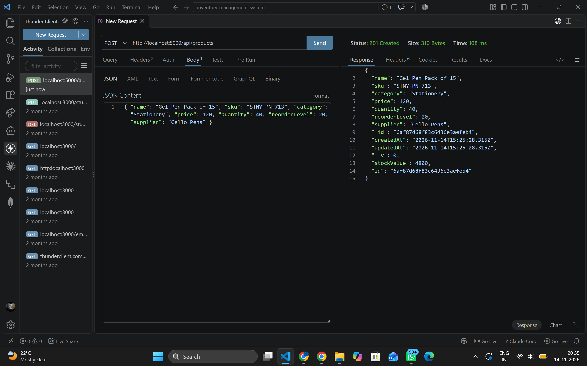
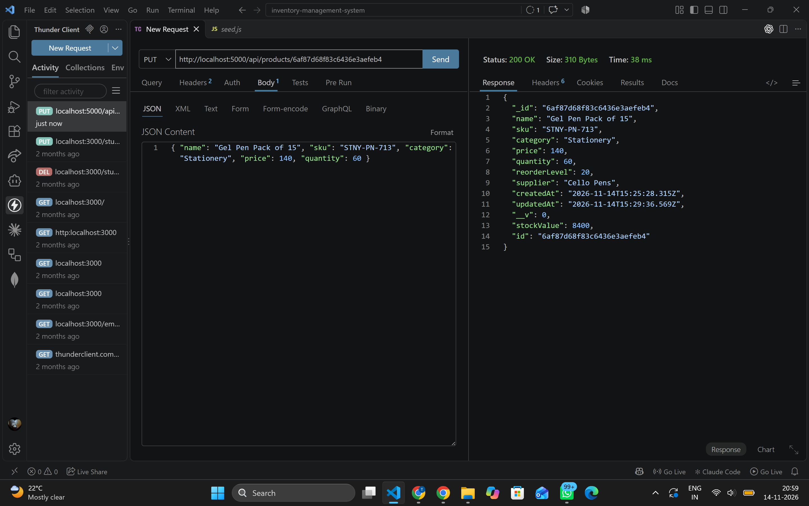
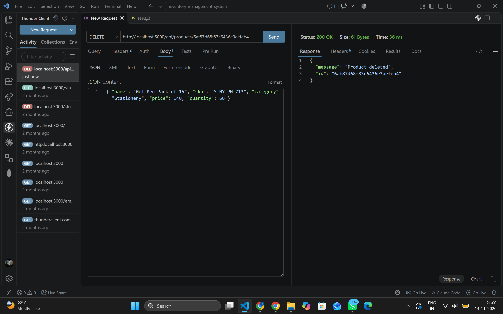
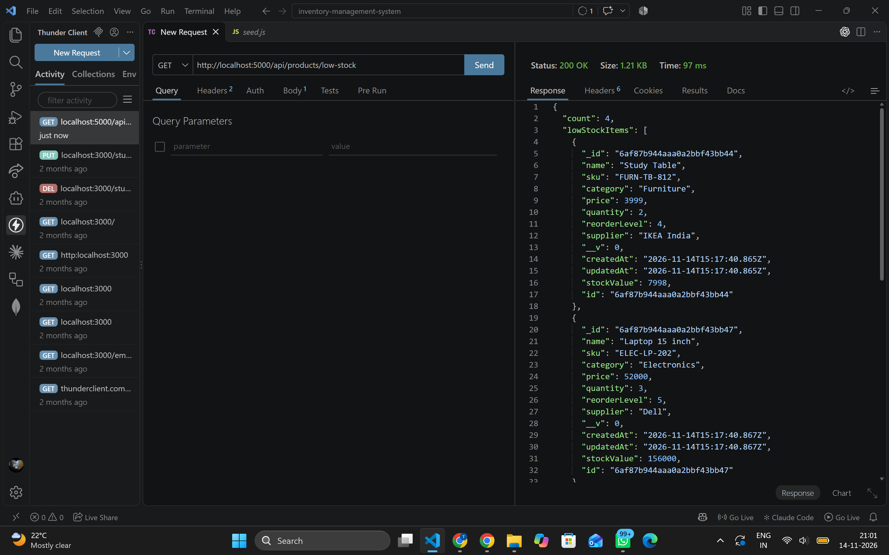
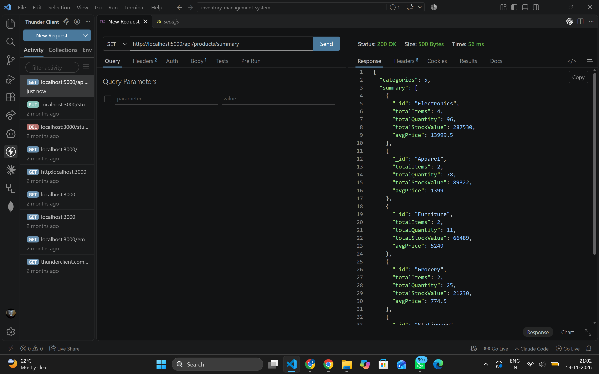
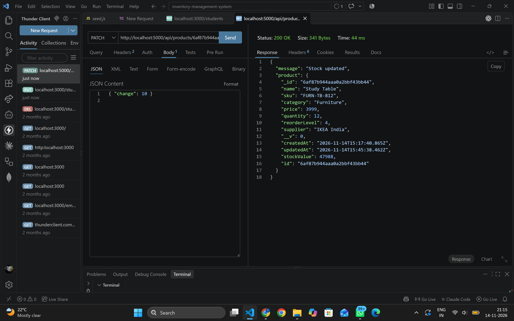

# Assignment 3: Inventory and Data Management System

## Aim

To build a RESTful backend using Node.js, Express.js and MongoDB (Mongoose) that manages a product catalogue: CRUD operations, stock adjustment, filtering, sorting, pagination and inventory reports using aggregation.

## Tools Used

Node.js, Express.js, MongoDB, Mongoose, dotenv, Postman (for testing)

## Steps to Run

1. `npm install`
2. Start MongoDB and set `PORT` and `MONGO_URI` in `.env`
3. `node server.js`
4. Test the APIs in Postman/Thunderclient at `http://localhost:5000/api/products`

---

## Output

### 1. Get All Product

### 2. Product Details

### 3. Create Product

### 4. Update Product

### 5. Delete Product

### 6. Stock Management

### 7. Inventory Report

---

## Features Implemented

- Mongoose schema with field-level validation (required, unique, enum, min, default)
- Complete CRUD for products
- Filtering (`category`, `search`, `minPrice`, `maxPrice`), sorting (`sort=-price`) and pagination (`page`, `limit`)
- Safe stock increment and decrement using `$inc`
- Aggregation reports: low-stock and category summary
- Centralized error handling: validation error (400), invalid id (400), duplicate SKU (409), not found (404)
- Environment variables managed with dotenv

## Conclusion

The Inventory Management API was built and tested successfully. All endpoints work as expected, with proper validation, error handling and aggregation reports.
